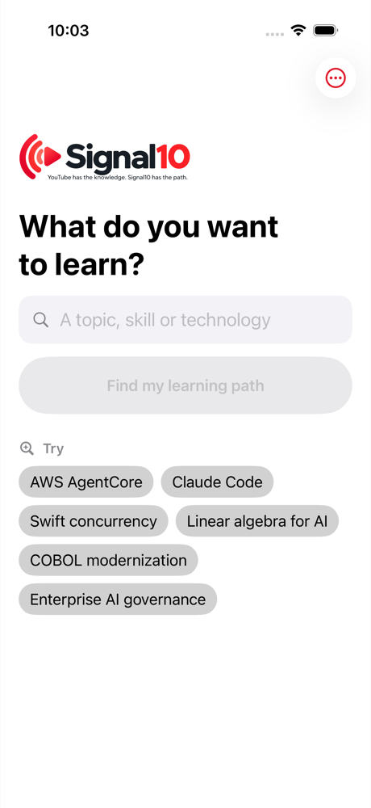
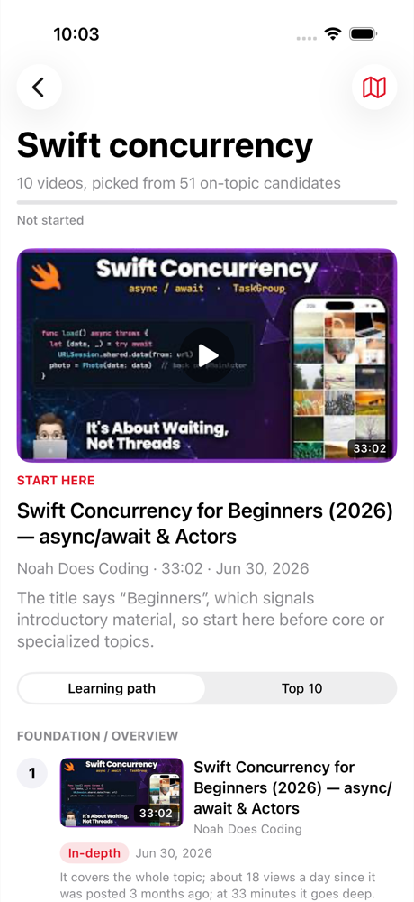
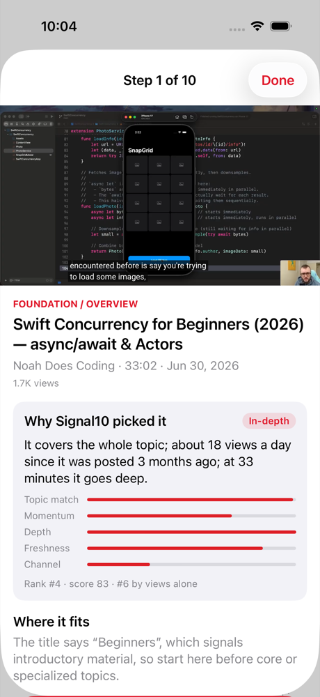
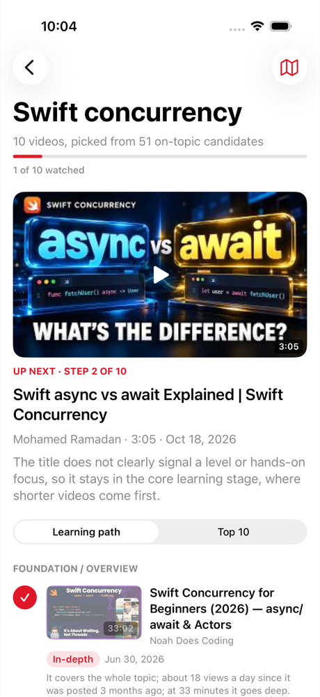

# Signal10 for iPhone

A native SwiftUI client for the Signal10 server in this repository. It asks "What do you want to learn?", fetches the Top 10 from `/api/top10`, and walks the user through the learning path: start here, watch, mark watched, see what is next. The intent is [intents/ios-app.md](../intents/ios-app.md).

| Home | Results | Player | Continue |
| --- | --- | --- | --- |
|  |  |  |  |

## How it fits

The app holds no Signal10 logic of its own. Searching, ranking, de-duplication, reasons, learning-path stages, free reading and Architect View all come from the server, through the same routes the web page uses:

| Route | Used for |
| --- | --- |
| `POST /login` | Sign-in. The server's session cookie is kept by the system cookie store for its seven days |
| `GET /api/top10?topic=` | The Top 10, learning path, "Did you mean" and free reading |
| `GET /api/architect?topic=` | Architect View, fetched only when the user opens it |
| `POST /logout` | Sign out |

The app compiles in only the server's address. It holds no API key, no model name and no provider: the server owns the model call, so the server can change models or providers without an app update. The password is sent to the server once and is not stored. Watched videos and the five recent searches are kept on the device.

Videos play in YouTube's own embedded player (`youtube-nocookie.com`, as on the web page), with "Open on YouTube" for creators who turn off embedding.

## Build and run

Requires Xcode 26 and the Signal10 server (see the [main README](../README.md)). The Xcode project is committed, so nothing else is needed. `xcodegen` is only needed if you edit `project.yml`.

### Simulator, against a local server

```bash
npm start
```

```bash
open ios/Signal10.xcodeproj
```

Pick an iPhone simulator and press Run. Debug builds talk to `http://localhost:4310` (`ios/Config/Debug.xcconfig`). Sign in with the `SIGNAL10_USERNAME` and `SIGNAL10_PASSWORD` from your `.env`.

### A real iPhone, against the deployed server

A phone cannot reach your Mac's `localhost`, so use the Release configuration, which points at the Lambda Function URL in `ios/Config/Release.xcconfig`:

1. Connect the iPhone and turn on Developer Mode (Settings › Privacy & Security).
2. In Xcode, choose Product › Scheme › Edit Scheme › Run, and set Build Configuration to **Release**.
3. Choose the phone as the destination and press Run. Signing uses team `3MA883Y6R4`; change it under Signing & Capabilities if needed.
4. Sign in with the deployed server's credentials, then check: search **AWS AgentCore**; ten videos appear; tap **Start here**; the video plays; **Mark watched · play next** moves to step 2; **Done** shows "Up next · Step 2 of 10"; **Open on YouTube** opens the YouTube app, and switching back returns to the same place; the map button opens Architect View.

If you redeploy to a new URL, update `SIGNAL10_BASE_URL` in `Release.xcconfig`.

## Tests

Unit tests (decoding real replies, sign-in, error handling, recent searches, progress, player safety, no secrets in settings) need no server:

```bash
xcodebuild test -project ios/Signal10.xcodeproj -scheme Signal10 -destination 'platform=iOS Simulator,name=iPhone 17 Pro'
```

The end-to-end UI test (`Signal10UITests`) signs in, searches, plays step 1, marks it watched and checks that "Up next" moves on, saving a screenshot at each step. It is skipped unless credentials are supplied, and they are only ever read from the environment:

```bash
TEST_RUNNER_SIGNAL10_USERNAME=you TEST_RUNNER_SIGNAL10_PASSWORD=secret TEST_RUNNER_SIGNAL10_SCREENSHOT_DIR=/tmp/shots xcodebuild test -project ios/Signal10.xcodeproj -scheme Signal10 -destination 'platform=iOS Simulator,name=iPhone 17 Pro' -only-testing:Signal10UITests SIGNAL10_BASE_URL=http://localhost:4310
```

Add `TEST_RUNNER_SIGNAL10_TOPIC="Swift concurrency"` to search something other than AWS AgentCore.

## Layout

| Path | Contents |
| --- | --- |
| `project.yml` | XcodeGen source for the project |
| `Config/` | The server address per configuration |
| `Signal10/Core/` | Reply models, the server client, topic rules, recent searches, watched progress, the embed URL |
| `Signal10/App/` | App-wide state |
| `Signal10/UI/` | Home, results, player, Architect View, sign-in |
| `Signal10Tests/` | Unit tests and recorded server replies |
| `Signal10UITests/` | The end-to-end flow |

## Known limitations

- **Sign-in is the server's shared username and password.** Fine for the owner and testers; public App Store users will need real accounts or no sign-in, which is a server change first.
- **Watched progress lives on one device** and is keyed by topic, so a new search for the same topic that returns different videos starts those videos unwatched.
- **Some videos will not play inside the app.** Creators can turn off embedding; the player then shows YouTube's message and "Open on YouTube" is the way through.
- **iPhone, portrait only.** No iPad layout yet.
- **Not checked on a physical iPhone by the implementer.** The Release build compiles for devices and the flow passes in the Simulator; the device check above is manual.
